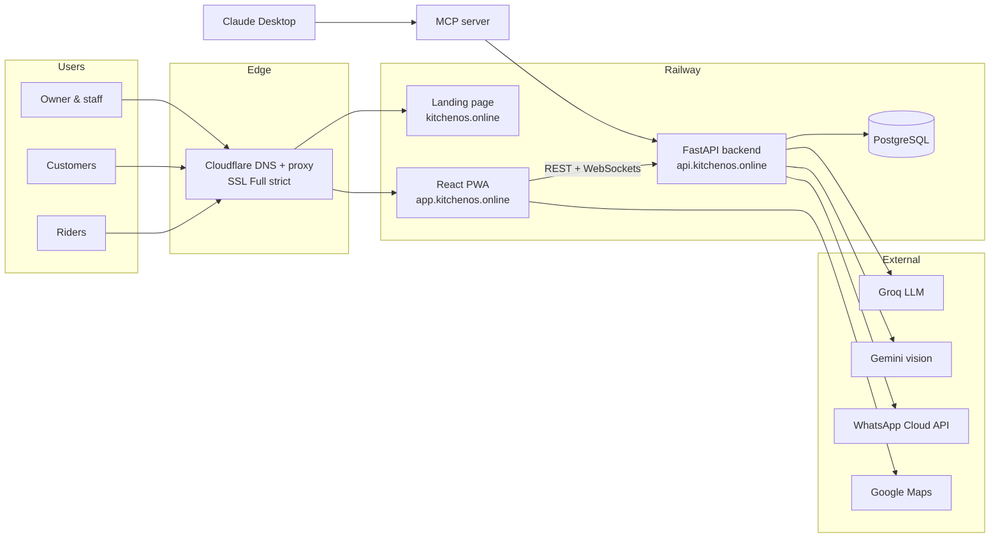

# KitchenOS — Cloud Kitchen & Restaurant Management Platform

**Live:** [www.kitchenos.online](https://www.kitchenos.online)  ·  **Sister product:** [BarOS](https://www.baros.store)  ·  **Built by:** Vijay Kumar A (Jayron Technologies)

KitchenOS is a multi-branch SaaS platform for Indian cloud kitchens and restaurants that sell on Swiggy and Zomato. It manages inventory, recipes, orders, delivery, staff and finances in one place, and uses AI agents to automate everyday work like reading supplier bills.

> The source code is private. This repository shows the product, its architecture and the engineering behind it. A live demo is available on request.

---

## Screenshots

<!-- Add screenshots to a /screenshots folder and update these paths -->
| Home dashboard | Inventory | AI chatbot |
|---|---|---|
|  |  |  |

| Bill reader agent | Delivery & rider tracking | Customer ordering PWA |
|---|---|---|
|  |  |  |

---

## What it does

- **Inventory & recipes:** ingredient stock, recipe costing, low-stock alerts, wastage tracking and smart restock suggestions
- **Dishes & pricing:** per-platform selling prices (Swiggy, Zomato, direct) with live profit-and-loss preview and margin visibility
- **Orders & KOT:** kitchen order tickets, dine-in, pickup/takeaway and online orders, with inventory restored on cancellation
- **Multi-branch:** branch-level data isolation, opening hours, and a per-branch online/offline switch for orders
- **Staff & roles:** owner, captain, cashier, head chef and rider roles, each seeing only what they need
- **Delivery:** in-house delivery with live rider tracking and Google Maps directions
- **Customer PWA:** a mobile web app where customers order directly from the kitchen
- **Alerts:** WhatsApp notifications using approved Meta message templates
- **Business insights:** Home dashboard with Business Pulse, live rider board, monthly target, top dish and smart alerts

---

## AI features

| Feature | What it does | Built with |
|---|---|---|
| **KitchenBot** (AI assistant) | Owners ask questions about sales, stock and orders in plain language and get answers built from their own kitchen's data | Groq LLM API, retry logic, response-formatting rules |
| **Bill reader agent** | Reads a supplier's stock bill (PDF or Word), extracts the items, quantities and prices, and adds them to inventory | Google Gemini (vision), agent workflow inside the FastAPI backend |
| **Demand forecasting** | Predicts upcoming sales per dish to help plan purchasing | Prophet time-series forecasting |
| **MCP server** (experiment) | Exposes KitchenOS data as tools through the Model Context Protocol, so an owner can query their kitchen from Claude Desktop | Model Context Protocol (Python) |

---

## Architecture

**How a request flows**

1. Users reach the app through Cloudflare, which handles DNS, SSL and routing (this also fixed mobile-carrier routing failures seen on some Indian networks).
2. The React PWA calls the FastAPI backend over REST through one shared Axios client with consistent 401/403 handling.
3. The backend checks the user's role and branch on every request, then reads or writes PostgreSQL through SQLAlchemy.
4. Live updates, such as rider locations, travel over WebSockets.
5. AI features call Groq or Gemini from the backend, so API keys never reach the browser.

---

## Tech stack

| Layer | Technologies |
|---|---|
| **Frontend** | React 18, Vite, TailwindCSS, React Query, Zustand, PWA (Workbox), IndexedDB |
| **Backend** | Python 3.11, FastAPI, SQLAlchemy, Pydantic, Uvicorn, WebSockets |
| **Database** | PostgreSQL |
| **AI / ML** | Groq LLM API, Google Gemini (vision), Prophet, Model Context Protocol |
| **Integrations** | WhatsApp Cloud API (Meta templates), Google Maps |
| **Infrastructure** | Railway, Cloudflare, Docker, Git |

---

## Engineering highlights

- **Role-based access control (RBAC):** rebuilt permissions across ~20 backend routers with a shared `get_current_actor` / `require_permission` pattern, branch isolation, and financial data removed from staff responses
- **Offline resilience:** an IndexedDB outbox queues actions when the network drops and replays them later; every request carries a `client_request_id` so retries never create duplicate orders
- **Performance:** composite database indexes, SQL-side aggregations, N+1 query fixes, GZip compression, background tasks for WhatsApp alerts, and Rollup code splitting on the frontend
- **Reliability:** an app-wide error boundary, optimistic updates on delivery status, a `NoBranchGate` pattern that replaces endless spinners, and NetworkFirst API caching so the PWA never shows stale data
- **Safety:** rate limiting on the public customer order endpoint, and removal of a dangerous data-truncation endpoint found during an audit

---

## BarOS

[BarOS](https://www.baros.store) is a bar-management variant built on the same architecture and stack, adapted for bar inventory and operations.

---

## Contact

**Vijay Kumar A** — Generative AI Engineer & Founder, Jayron Technologies
📧 vijaykumar07kolar@gmail.com  ·  🌐 [kitchenos.online](https://www.kitchenos.online)
